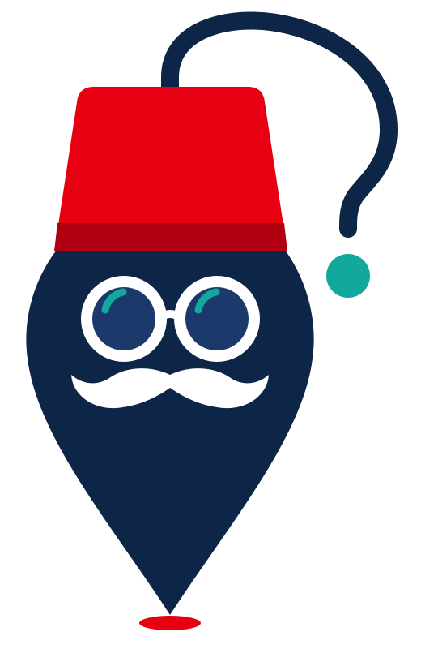

<p align="center">
  
</p>

# Win Wselna? – Citizen Platform for Public Services

> **"Win wselna?" (وين وصلنا؟) – "Where are we at?"**
> The question every Tunisian asks about a road under construction, a bus that never comes or a problem in the street.
> *The state in your pocket.*


---

## Table of Contents

- [Overview](#overview)
- [Features](#features)
- [Tech Stack](#tech-stack)
- [Architecture](#architecture)
- [Contributors](#contributors)
- [Academic Context](#academic-context)
- [Getting Started](#getting-started)
- [Usage](#usage)
- [Contributing](#contributing)
- [License](#license)
- [Acknowledgments](#acknowledgments)

---

## Overview

This project was developed as part of the **Web Technologies Project (PW) – 2nd Year Engineering Program** at **Esprit School of Engineering** (Academic Year 2026–2027).

**Win Wselna?** is a full-stack web platform that brings six public services together behind **one citizen account**. It answers the theme *Digital transformation, economic innovation and smart cities*, combined with artificial intelligence and sustainable development.

**The problem.** Citizens went mobile, the state did not:

- official news arrives late and is mixed with rumours;
- public projects are announced, then nobody knows where they are at;
- reclamations disappear without any follow-up, and public transport gives no live information or online tickets;
- citizens are rarely consulted, and local jobs created by public works are not visible.

**Our answer.** One website where a citizen can read verified news, follow public projects milestone by milestone, submit and track reclamations, check bus and metro lines and buy tickets online, register for public consultations and apply to jobs created by the projects near them. Every action follows the same visible path: *submit → processed by an agent → answered → done.*

**Main objective (SDG 16):** rebuild trust between citizens and institutions through transparency and traceability.

---

## Features

The platform is organised in **6 modules**, each built on **2 entities** with full **CRUD**, plus a shared **User** entity for authentication (13 tables in total).

| Module | Question it answers | Entities | Main features |
|---|---|---|---|
| **Win News** | *"What's happening today?"* | `Category` → `Article` | Articles by category, search and filters, 60-second AI summary, article linked to a project |
| **Win Projects** | *"Where is this project at?"* | `Project` → `Milestone` | Project list and details, progress bar, milestone timeline, follow a project, linked events and jobs |
| **Win Safe** | *"Who fixes this pothole?"* | `Reclamation` → `Response` | Submit a reclamation (type, location, photo), edit or cancel while *Sent*, status tracking, agent responses |
| **Win Transport** | *"Where's my bus?"* | `TransportLine` → `Ticket` | Bus, metro, train and louage lines with their status during public works, buy a ticket online with a QR code, cancel it, validation on board by an agent |
| **Win Event** | *"Can I have my say?"* | `Event` → `Participation` | Public consultations, meetings and openings, registration with capacity check, attendance |
| **Win Jobs** | *"Is there work near me?"* | `JobOffer` → `Application` | Job offers created by public projects, apply with a CV, track or withdraw an application |
| **Win Account** | – | `User` | Sign up, log in, profile, roles **Client · Agent · Admin** |

**Front office (citizen side)**
- Responsive home page with live figures, latest news, nearby projects, events and jobs
- "My space": all of the client's reclamations, tickets, registrations and applications in one place
- **3am Win**, the assistant mascot, answering in Darija, Arabic or French
- Client-side input validation on every form (required fields, email, Tunisian phone number, lengths, files, dates)

**Back office (dashboard)**
- Dashboard with KPIs, charts (reclamations received vs resolved, tickets by status) and activity per module
- One CRUD page per entity: search, filter, sortable columns, pagination, add / edit form, delete confirmation
- Reclamation detail with response thread; ticket validation panel; accept / refuse panel for applications
- Role-based navigation: **Admin** manages all content and users, **Agent** answers reclamations, validates tickets and updates milestones

---

## Tech Stack

### Frontend
- **HTML5** – semantic pages, split into reusable includes
- **CSS3** – custom design system (no framework): CSS variables, Grid, Flexbox, responsive layout
- **JavaScript (vanilla ES6)** – modals, tabs, filters, form validation, data tables, SVG charts, chat widget
- **Google Fonts** – Poppins (headings), Inter (body), Cairo (Arabic)

### Backend
- **PHP 8** – MVC architecture, template integration with `require_once`
- **MySQL / MariaDB** – relational database (InnoDB, foreign keys, `utf8mb4`)
- **XAMPP** – Apache + PHP + MySQL local server, **phpMyAdmin** for administration

### Tools
- **Git & GitHub** – version control and collaboration
- **VS Code** – development
- **UML** – use case diagrams (global + one per module) and class diagram

---

## Architecture

The project follows the **MVC (Model – View – Controller)** pattern.

```
winwselna/
├── index.php               # single entry point (front controller): index.php?action=...
├── Config/                 # database.php (PDO singleton) · config.php (constants, helpers)
├── Controller/             # AuthController · UserController · StatsController (all the business logic)
├── Model/                  # UserModel (attributes, getters/setters only)
├── View/                   # user interface (opening View/ lists only frontoffice/ and backoffice/)
│   ├── frontoffice/        # website: home, news, projects, reclamations, transport, events, jobs, login, register, account
│   │   └── includes/       # shared parts: head, spinner, navbar, footer, flash, scripts
│   ├── backoffice/         # dashboard, users, profile + one page per module entity
│   │   └── includes/       # shared parts: head, sidebar, topbar, footer, scripts
│   ├── errors/             # 403 (access denied) · 404 (page not found)
│   ├── css/                # common.css (design system) · style.css (front) · admin.css (back)
│   ├── js/                 # common.js · main.js (front) · admin.js (back)
│   ├── img/                # logo, icons, illustrations
│   └── lib/                # third-party libraries
├── winwselna.sql           # database schema (13 tables, foreign keys)
└── README.md
```

**Template integration.** Every page assembles the common blocks (`head`, `spinner`, `navbar`, `footer`, `scripts`) with `require_once`. Each page sets a `$page` variable so the navbar highlights the active link.

**Database (13 tables).**

```
users ─┬─< reclamations >─┬─ projects ─┬─< milestones
       │        └─< responses          ├─< articles >── categories
       ├─< tickets >── transport_lines ─┤
       ├─< participations              ├─< events ─< participations >── users
       └─< applications                └─< job_offers ─< applications >── users
```

| Link | Foreign key |
|---|---|
| Category classifies Article | `articles.category_id` |
| Article covers Project | `articles.project_id` (optional) |
| Project has Milestones | `milestones.project_id` (cascade) |
| Reclamation concerns Project | `reclamations.project_id` (optional) |
| User submits Reclamation | `reclamations.user_id` |
| Reclamation answered by Response | `responses.reclamation_id` |
| TransportLine is served / improved by Project | `transport_lines.project_id` (optional) |
| TransportLine sells Tickets | `tickets.line_id` |
| User buys Ticket | `tickets.user_id` |
| Event is about Project | `events.project_id` (optional) |
| Event receives Participations | `participations.event_id` |
| User registers (Participation) | `participations.user_id` |
| Project offers JobOffers | `job_offers.project_id` |
| JobOffer receives Applications | `applications.job_offer_id` |
| User applies (Application) | `applications.user_id` |

**Actors.** `Client` (citizen) · `Agent` (municipal agent) · `Admin` (platform administrator).

---

## Contributors

**Team Aura Nova**

| Member | Module | Entities |
|---|---|---|
| Omar Abidi | Win News | Category, Article |
| Nourelhouda Haj Mefteh | Win Projects | Project, Milestone |
| Majdi Khaldi | Win Safe | Reclamation, Response |
| Jasser Aouedi | Win Transport | TransportLine, Ticket |
| Fatma Tlili | Win Event | Event, Participation |
| Eya Sallem | Win Jobs | JobOffer, Application |

The shared `User` entity (authentication and roles) is built by the whole team.

---

## Academic Context

Developed at **Esprit School of Engineering – Tunisia**
**Web Technologies Project (PW) – 2A | Academic Year 2026–2027**

- **Theme:** Digital transformation, economic innovation and smart cities + Artificial intelligence + Sustainable development
- **Sustainable Development Goals:** SDG 16 (core) · SDG 11 · SDG 8 · SDG 9 · SDG 3 · SDG 10 · SDG 17

---

## Getting Started

### Prerequisites

- [XAMPP](https://www.apachefriends.org/) (Apache, PHP 8, MySQL / MariaDB, phpMyAdmin)
- [Git](https://git-scm.com/)
- A modern browser (Chrome, Edge, Firefox)

### Installation

1. **Clone the repository** into the XAMPP `htdocs` folder:
   ```bash
   cd C:/xampp/htdocs
   git clone https://github.com/<organisation>/Esprit-PIWEB-2A-2027-WinWselna.git winwselna
   ```
2. **Start Apache and MySQL** from the XAMPP Control Panel.
3. **Create the database:**
   * open [http://localhost/phpmyadmin](http://localhost/phpmyadmin)
   * click **Import**, choose `winwselna.sql`, then click **Go**
   * the `winwselna` database is created with its 13 empty tables and all foreign keys
4. **Configure the connection** in `Config/` (host `localhost`, user `root`, empty password by default on XAMPP, database `winwselna`).

---

## Usage

Every page goes through the single entry point `index.php?action=...` (MVC front controller).

| Page | URL |
|---|---|
| Choose a space (lists `frontoffice/` and `backoffice/`) | [http://localhost/winwselna/](http://localhost/winwselna/) → `View/` |
| Website (front office) | [http://localhost/winwselna/View/frontoffice/](http://localhost/winwselna/View/frontoffice/) |
| Back office (login required) | [http://localhost/winwselna/View/backoffice/](http://localhost/winwselna/View/backoffice/) |
| Log in (every role) | [http://localhost/winwselna/index.php?action=login](http://localhost/winwselna/index.php?action=login) |
| Sign up | [http://localhost/winwselna/index.php?action=register](http://localhost/winwselna/index.php?action=register) |
| Dashboard (admin / agent) | [http://localhost/winwselna/index.php?action=admin](http://localhost/winwselna/index.php?action=admin) |

* **One login page for everyone.** After login the role stored in the database decides where the user goes: `ADMIN` and `AGENT` → dashboard, `CLIENT` → website and "My space".
* **First administrator:** sign up normally (the role is always `CLIENT`), then in phpMyAdmin set `role = 'ADMIN'` for that user in the `users` table and log in again. That admin can then create agents and other admins in **Users & roles**.
* **Access rules:** an agent sees the dashboard, milestones, reclamations and tickets; only an admin manages users and the other modules. Any other page answers **403 Access denied**.
* **Security:** passwords hashed with `password_hash()`, prepared statements (PDO), CSRF token on every form, `session_regenerate_id()` at login, session cookie `HttpOnly` + `SameSite=Lax`, 30-minute inactivity timeout, security headers (CSP, X-Frame-Options…), view files not reachable directly.
* PHP pages must be opened through Apache (`http://localhost/...`), not by double-clicking the file.

---

## Contributing

1. **Fork** the repository.
2. Create a branch for your feature:
   ```bash
   git checkout -b feature/module-name
   ```
3. Commit your changes with a clear message:
   ```bash
   git add .
   git commit -m "Add CRUD for reclamations"
   ```
4. Push the branch:
   ```bash
   git push origin feature/module-name
   ```
5. Open a **Pull Request** describing what you changed.

Each team member works on the branch of their own module; changes to shared files (`includes/`, `css/common.css`, `User`) are discussed with the team first.

---

## License

This project was developed for **educational purposes** at **Esprit School of Engineering**.
It is distributed under the **MIT License** – you can use, modify and share the code as long as the original copyright notice is kept. See the `LICENSE` file for details.

---

## Acknowledgments

- **Esprit School of Engineering** – for the Web Technologies project framework and supervision
- Our **tutors and teachers** of the Web Technologies module for their guidance
- The open-source community: Google Fonts, PHP, MariaDB, XAMPP
- Every citizen who has ever asked *"win wselna?"* – this project is for you

---

<p align="center"><b>Team Aura Nova · Esprit School of Engineering · 2026–2027</b><br><i>الدولة في جيبك – The state in your pocket</i></p>
